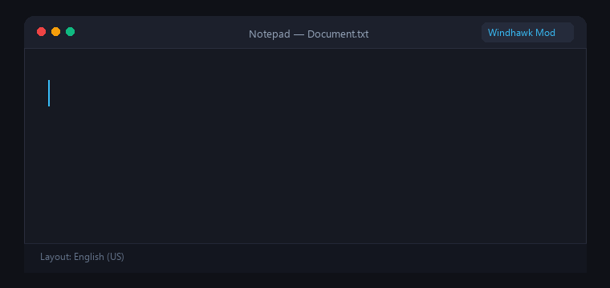

<div dir="rtl">

# ⌨️ KeyboardFixer — مصحّح لوحة المفاتيح العربي/الإنجليزي

**أداة نظام خفية وسريعة على Windows، تحوّل النص الذي كتبته بالخطأ من لغة إلى أخرى بضغطة زر واحدة.**

<p align="center">
  <a href="https://windhawk.net/mods/arabic-keyboard-layout-fixer"></a>
  <a href="https://github.com/uomr/keyboard-layout-fixer/releases"></a>
  <a href="LICENSE"></a>
</p>

---

## 🎯 المشكلة التي تحلّها

هل حدث لك هذا من قبل؟

```
أردت أن تكتب: السلام عليكم
فكتبت:         hghsghl ugd;l
```

أو العكس:
```
أردت أن تكتب: Hello World
فكتبت:         هيممخ صخقمي
```

**KeyboardFixer** يصلح هذا فوراً وبدقة، في أي نافذة أو تطبيق، دون الحاجة لحذف ما كتبته وإعادة كتابته!

---

</div>

## 📺 Demo

<div align="center">



</div>

```
قبل التحويل:    hghsghl ugd;l
اضغط Alt+Z  →
بعد التحويل:    السلام عليكم
```

```
Before:    السلام عليكم في هذا العالم الجميل
Press Alt+Z  →
After:     hghsghl ugd;l td i`h hgughl hg[ldg
```

---

<div dir="rtl">

## ✨ المميزات الرئيسية

| الميزة | التفاصيل |
|--------|----------|
| 🌍 **يعمل في كل مكان** | Notepad، Word، Chrome، VS Code، WhatsApp Web، وبرامج ERP القديمة |
| ⚡ **فائق السرعة** | التحويل يتم آنيًا في أقل من 50ms |
| 🧠 **كشف تلقائي للاتجاه** | يكتشف لغة النص تلقائيًا ويحولها (عربي ← إنجليزي أو إنجليزي ← عربي) |
| 🔤 **معالجة متقدمة لـ (لا)** | يدعم كافة أشكال اللام-ألف المتصلة والمنفصلة (لا، لأ، لإ، لآ) |
| 🔡 **يتعامل مع Caps Lock** | يعالج الأحرف الكبيرة المكتوبة بالخطأ تلقائيًا |
| 🔢 **حماية الأرقام والرموز** | الأرقام والرموز الشائعة تمر دون أي تشويه |
| 🔇 **خفيف وخفي** | لا يستهلك موارد الجهاز إطلاقًا ويعمل بصمت في الخلفية |

---

## 🚀 طرق التثبيت والاستخدام

### 🥇 الخيار الأول: عبر متجر Windhawk الرسمي (موصى به بشدة ⭐)

الأداة معتمدة ومنشورة رسميًا في متجر **Windhawk Mods**:
1. قم بتثبيت [Windhawk](https://windhawk.net/) إن لم يكن لديك.
2. توجّه إلى تبويب **استكشاف (Explore)** وابحث عن:
   `Arabic Keyboard Layout Fixer`
   أو افتح الرابط المباشر: [windhawk.net/mods/arabic-keyboard-layout-fixer](https://windhawk.net/mods/arabic-keyboard-layout-fixer)
3. اضغط **تفاصيل (Details)** ثم **تثبيت (Install)**.
4. مبروك! الأداة تعمل الآن مدى الحياة في الخلفية عبر `Alt + Z`.

---

### 🥈 الخيار الثاني: التطبيق المستقل (Standalone C# — بدون Windhawk)

**التثبيت الآلي السريع بنقرة واحدة (PowerShell):**

```powershell
# افتح PowerShell (بدون الحاجة لصلاحيات مسؤول) والصق الأمر التالي:
Set-ExecutionPolicy -Scope CurrentUser Bypass -Force
git clone https://github.com/uomr/keyboard-layout-fixer.git
cd keyboard-layout-fixer
.\build.ps1 -Install
```

هذا الأمر سيقوم تلقائياً بـ:
- ✅ بناء الملف التنفيذي `KeyboardFixer.exe`
- ✅ نقله إلى مجلد التطبيقات الآمن على جهازك
- ✅ تشغيله مع بدء Windows
- ✅ إنشاء اختصار تشغيل وتفعيله فورًا

---

## ⌨️ اختصارات الاستخدام

| الاختصار | الوظيفة |
|----------|---------|
| `Alt + Z` | تحويل النص المظلل فورًا |
| `Ctrl + Shift + X` | اختصار بديل مدمج في حال تعارض Alt+Z مع تطبيق مخصص |

---

## 🏗️ البناء يدوياً من المصدر (للمطورين)

**المتطلبات:**
- Windows 10 / 11
- .NET Framework 4.x (مدمج افتراضيًا في النظام)

```powershell
# للبناء فقط:
.\build.ps1

# للبناء والتثبيت والتشغيل المباشر:
.\build.ps1 -Install
```

الملف الناتج يظهر في: `bin\KeyboardFixer.exe`

---

## 📁 هيكل المشروع

```
keyboard-layout-fixer/
│
├── demo.gif                   # العرض التوضيحي المتحرك
├── src/
│   └── KeyboardFixer.cs       # الكود المصدري المستقل (C# / Win32 API)
│
├── docs/
│   └── keyboard-map.md        # خريطة تحويل المفاتيح العربية والإنجليزية
│
├── build.ps1                  # سكريبت الأتمتة والبناء
├── CONTRIBUTING.md             # إرشادات المساهمة والتطوير
├── LICENSE                    # رخصة MIT
└── README.md
```

---

## 🔒 الخصوصية والأمان

- **يعمل محليًا 100%** — دون أي اتصال بالإنترنت أو إرسال بيانات.
- **لا تسجيل للضغطات (Zero Keylogging)** — الأداة تستمع فقط لاختصار التحويل.
- **مفتوح المصدر بالكامل** — كل سطر برمجي متاح للمعاينة والتدقيق.

---

## 🛠️ إزالة التثبيت (للتطبيق المستقل)

```powershell
Remove-ItemProperty -Path "HKCU:\Software\Microsoft\Windows\CurrentVersion\Run" -Name "KeyboardFixer" -ErrorAction SilentlyContinue
Remove-Item "$env:LOCALAPPDATA\KeyboardFixer" -Recurse -Force -ErrorAction SilentlyContinue
Remove-Item "$env:USERPROFILE\Desktop\KeyboardFixer.lnk" -Force -ErrorAction SilentlyContinue
Write-Host "✅ تم حذف الأداة بالكامل بنجاح"
```

---

## خارطة الطريق والمساهمة

المساهمات مرحب بها دائمًا! راجع [CONTRIBUTING.md](CONTRIBUTING.md).

- [x] إطلاق النسخة الرسمية على متجر Windhawk (الإصدار v1.3.1)
- [x] إضافة العرض التوضيحي المتحرك (Interactive Demo GIF)
- [ ] دعم لغات ثنائية الاتجاه إضافية (العبرية، الأوردو)
- [ ] واجهة رسومية خفيفة لتخصيص مفاتيح الاختصار

---

## 📄 الرخصة

مرخص تحت رخصة [MIT](LICENSE) © 2026.

<div align="center">

⭐ **إذا نالت الأداة إعجابك، لا تنسَ وضع نجمة على المستودع!** ⭐

</div>
